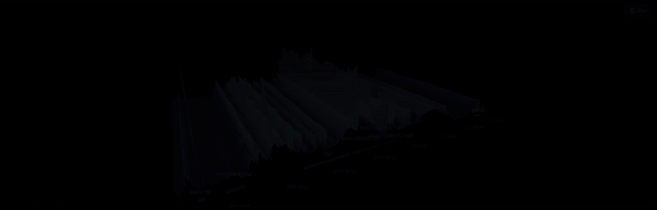

# RTL-SDR Scanner

[English](README.md) · **Català**

Aplicació web local per descobrir quins senyals de ràdio hi ha a casa amb un **RTL-SDR Blog V3** i, quan es pot, quin dispositiu els emet i quines dades envia. Només recepció.



*Un escombrat real de 24 MHz a 1,7 GHz amb l'antena de sèrie. [Vídeo de 22 segons (MP4)](docs/demo.mp4).*

- **Espectre**: escombrats amb `rtl_power`, waterfall en temps real, detecció de pics sobre el soroll de fons i classificació per banda (ES/UE).
- **Espectre 3D**: els mateixos escombrats com un paisatge que es pot girar: amplada = freqüència, alçada = intensitat, profunditat = temps. És el waterfall en volum, no un mapa d'on venen els senyals (amb una sola antena no hi ha direcció).
- **Dispositius**: `rtl_433` saltant entre 433,92 i 868,3 MHz. Dedup per model+id+canal, històric de lectures, àlies, filtre «probablement meu / veïns».
- **Avions**: ADS-B a 1090 MHz amb `rtl_adsb` (ICAO, país pel bloc ICAO, indicatiu, altitud, posició, velocitat, rumb).
- **Radar** (pestanya dins d'Avions): vista en planta centrada a casa (Lleida per defecte, configurable). Avions per posició real amb estela; la resta de dispositius en anells per RSSI amb direcció desconeguda (o manual, si l'has trobada amb una antena directiva).
- **Radar 3D**: els mateixos avions en tres dimensions al voltant de casa: rumb, distància i altitud reals, amb la tija fins a terra, l'estela i on serà cadascun d'aquí a dos minuts. Els sensors i comandaments, que no emeten posició, són anells a terra segons la força del senyal: com de prop, no cap on.
- **Auditoria**: superfície d'exposició de ràdio de casa: què emet en clar, què és identificable per ID, rutines horàries i recomanacions. Només metadades dels dispositius propis.
- **Hunt**: localitzar sensors LoRaWAN. Mode EU868: els 8 canals de ChirpStack (867,1–868,5 MHz) alhora en una sola finestra de 2,4 MHz centrada a 867,8 MHz (`rtl_sdr` IQ cru, canalitzador propi sense FFT), RSSI per canal 10×/s, llista de ràfegues amb canal i nivell, pic màxim, to sonor tipus detector de metalls amb «tic» a cada ràfega i volum, guany ajustable en calent. Mode alternatiu d'una sola freqüència (250 kHz).
- **Satèl·lits**: passos de NOAA-15/19 (APT) i Meteor-M2 3/4 (LRPT) sobre casa amb TLE de Celestrak (SGP4 via `satellite.js`), programació de captures que llancen **SatDump** pel `manager` i galeria de les imatges descodificades a `data/satellite/`.
- **Ràdio FM**: botó d'escolta als senyals de la banda FM (`rtl_fm` → PCM → Web Audio). Només radiodifusió: cap altra banda es reprodueix.
- **DAB**: ràdio digital descodificada per `welle-cli` **dins de Docker**; el Mac només executa `rtl_tcp` (osmocom) i el contenidor s'hi connecta per xarxa. Llista de programes i àudio MP3 a través del servidor.
- **Soroll (EMI)**: contaminació electromagnètica local a partir dels escombrats: perfil del soroll de fons per trams, pintes d'espuris (fonts commutades), trams de banda ampla (PLC, motors), portadores fixes, soroll per banda, evolució temporal i comparació abans/després amb una línia base per trobar l'aparell que embruta l'espectre. Són dB relatius sense calibrar: no mesura V/m ni límits de salut.
- **Calibratge a dBm (nivell 2)**: a la secció Soroll, amb un senyal de nivell conegut (generador, font de soroll o un mesurador extern): l'app agafa la lectura de l'escombrat i desa l'offset per guany; els altres guanys es deriven. Sense referència, estimació amb valors típics del R820T (±6 dB). Commutador dB/dBm a Soroll i Espectre. El Hunt (IQ cru, dBFS) té el seu propi calibratge (escala `iq`, estimació ±10 dB sense referència): retén una lectura en viu i indica el nivell real; així els seus dBm es poden comparar amb els del gateway. No dona V/m ni exposició (nivell 3: caldria el factor d'antena).
- **Històric**: tots els escaneigs es desen a SQLite i es poden tornar a obrir i exportar (CSV/JSON).

## Requisits

- macOS amb Homebrew, Node 22+ i pnpm.
- Eines SDR: `brew install librtlsdr rtl_433`.
- Satèl·lits (opcional): `brew install satdump` (cask; deixa `SatDump.app` a `/Applications`). El servidor crida el binari del bundle directament, perquè pel symlink de Homebrew SatDump no troba la seva configuració. Si el tens en un altre lloc: `SATDUMP_BIN=/ruta/satdump`.
- Descodificadors en Docker (opcional, per al DAB): Docker Desktop en marxa i la imatge construïda:
  ```bash
  docker build -t rtlsdr-decoders docker/decoders
  ```
  O bé `docker compose build`. El `docker-compose.yml` també té perfils per fer servir els descodificadors a mà: `docker compose run --rm dab` (welle-cli a http://localhost:7979, `DAB_CHANNEL=11B` per canviar de bloc), `docker compose run --rm rtl433` i `docker compose run --rm shell`; tots esperen `rtl_tcp` en marxa al Mac.
  La imatge (Debian) porta `welle.io`, `rtl-sdr` (osmocom) i `rtl_433`.
  Autotest del descodificador: `sh docker/decoders/selftest/run.sh` (descodifica una trama Nexus-TH sintètica dins del contenidor). Docker Desktop a macOS no pot accedir a l'USB: per això el dongle el gestiona `rtl_tcp` al Mac (port 1234) i el contenidor s'hi connecta a `host.docker.internal`. TDT (DVB-T) no és possible amb aquest dongle en mode SDR (cal 9 MS/s i arriba a 2,4).
- Comprova el dongle: `rtl_test -t` ha de llistar `Realtek, RTL2838UHIDIR`.

## Ordres

```bash
pnpm i
pnpm dev          # server (http://localhost:4000) + web (http://localhost:5173)
pnpm build
pnpm typecheck
pnpm lint
pnpm test         # vitest (server), amb fixtures reals del dongle
```

Variables opcionals del servidor: `PORT` (4000), `SDR_DB` (ruta de la base de dades, per defecte `data/sdr.db`), `SDR_SAT_DIR` (captures de satèl·lit, per defecte `data/satellite`), `SATDUMP_BIN`, `SDR_DEBUG=1` (mostra el stderr de les eines `rtl_*`).

## Estructura

```
server/src/
  index.ts          Fastify: REST + WebSocket /ws
  db.ts             esquema i consultes SQLite (better-sqlite3)
  types.ts          tipus compartits amb el web
  sdr/manager.ts    únic propietari del dongle: un sol mode actiu, cua, SIGINT→SIGKILL
  sdr/process.ts    llançament de processos rtl_* i detecció d'errors USB
  sdr/survey.ts     parser de rtl_power, assemblador d'escombrats, detecció de pics
  sdr/devices.ts    parser de rtl_433 i dedup
  sdr/adsb.ts       descodificador Mode S / ADS-B (CRC, indicatiu, altitud, CPR, velocitat)
  sdr/icao.ts       blocs d'adreces ICAO → país
  sdr/hunt.ts       mesurador de potència (una freqüència) i canalitzador EU868 de 8 canals a partir de l'IQ de rtl_sdr
  sdr/audit.ts      classificació d'exposició (en clar / ID / codi variable) i rutines
  sdr/satellite.ts  TLE (Celestrak, cau 12 h), predicció de passos SGP4, ordre de SatDump, galeria
  sdr/emi.ts        anàlisi de soroll: trams, pintes, banda ampla, portadores, comparació amb línia base
  sdr/calibration.ts offset dB→dBm per guany (calibrat, derivat o estimat)
  sdr/bands.ts      taula de bandes
server/test/        tests + fixtures capturades amb el dongle
web/src/
  pages/            Dashboard, Spectrum, Devices, Planes (+ Radar), Audit, Hunt, Satellites, Dab, Noise, History
docker/decoders/    Dockerfile dels descodificadors (welle-cli, rtl-sdr, rtl_433)
  components/       Waterfall i RadarCanvas (canvas), SignalsTable, DeviceDrawer, Layout…
  store.tsx         estat global alimentat pel WebSocket
```

## API

| Mètode | Ruta | Descripció |
| --- | --- | --- |
| GET | `/api/status` | mode actiu, estat del dongle, comptadors |
| POST | `/api/mode` | `{ mode: 'idle' \| 'survey' \| 'devices' \| 'adsb' \| 'hunt' \| 'audio' \| 'dab', config }` (el mode `satellite` es llança des de les captures) |
| GET | `/api/audio/stream` | PCM s16le mono 48 kHz de l'emissora FM en reproducció |
| GET / POST / DELETE | `/api/emi?scanId=`, `/api/emi/baseline` | anàlisi EMI d'un escombrat, fixar/esborrar la línia base |
| GET / POST / DELETE | `/api/calibration`, `/api/calibration/reading?scanId&freqHz`, `/api/calibration/:gain` | referències de calibratge, lectura d'un escombrat a una freqüència |
| GET / POST | `/api/dab/channels`, `/api/dab/mux`, `/api/dab/channel`, `/api/dab/mp3/:sid` | blocs, estat del múltiplex (proxy de welle-cli), canvi de bloc, àudio d'un programa |
| POST | `/api/dongle/check` | executa `rtl_test -t` (només en mode inactiu) |
| GET | `/api/bands` | taula de bandes |
| GET | `/api/signals?scanId=` | senyals detectats |
| GET | `/api/sweeps?scanId=&limit=` | escombrats (per tornar a obrir un waterfall) |
| GET | `/api/devices` | dispositius rtl_433 |
| GET | `/api/devices/:id/history` | lectures d'un dispositiu |
| PATCH | `/api/devices/:id` | `{ alias?, owner?: 'own' \| 'other' \| null, bearingDeg? }` |
| GET | `/api/audit` | exposició, activitat per hora i rutines dels dispositius propis |
| GET | `/api/satellite/info`, `/api/satellite/passes?lat&lon&hours`, `/api/satellite/captures` | satèl·lits, passos previstos, captures |
| POST / DELETE | `/api/satellite/captures[/:id]` | programa (o llança amb `now: true`) i cancel·la captures |
| GET | `/api/satellite/files/:id/*` | imatges d'una captura |
| GET | `/api/planes?scanId=` | avions |
| GET | `/api/scans`, `/api/scans/:id`, DELETE `/api/scans/:id` | històric |
| GET | `/api/export/:kind?format=csv\|json&scanId=&deviceId=` | `signals`, `devices`, `planes`, `sweeps`, `readings` |
| GET | `/api/satellite/antenna` | `reference/antena-137mhz.md` (mides de la V-dipole) |
| WS | `/ws` | `status`, `survey:sweep`, `survey:signals`, `device:new`, `device:update`, `adsb:plane`, `hunt:level`, `hunt:burst`, `satellite:capture`, `error` |

## Notes d'ús

- Només un procés pot fer servir el dongle. Canviar de mode atura l'anterior i espera que alliberi l'USB.
- `rtl_power` amb pas d'1 MHz fa un salt d'un sol bin per MHz (1676 salts de 24 a 1700 MHz, ~73 s per passada). Amb passos ≤ 500 kHz cada salt cobreix 2,8 MHz (599 salts, ~23 s per passada), per això el pas per defecte és 100 kHz.
- Bandes xifrades (mòbil, TETRA) només mostren «activitat detectada». No es descodifica ni es grava àudio de comunicacions privades.
- Satèl·lits: el planificador llança la captura 20 s abans de l'AOS i pren el dongle encara que hi hagi un altre mode actiu. SatDump descodifica en acabar el temps del pas i sempre genera imatges (encara que només hi hagi soroll): mira'n la qualitat a la galeria. Amb la vareta els resultats són pobres; cal una V-dipole de 137 MHz (2 braços de 53,4 cm a 120°) o una QFH.
