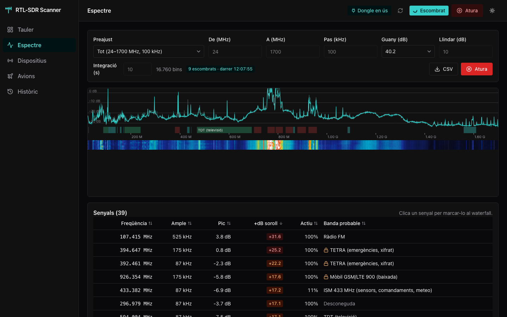
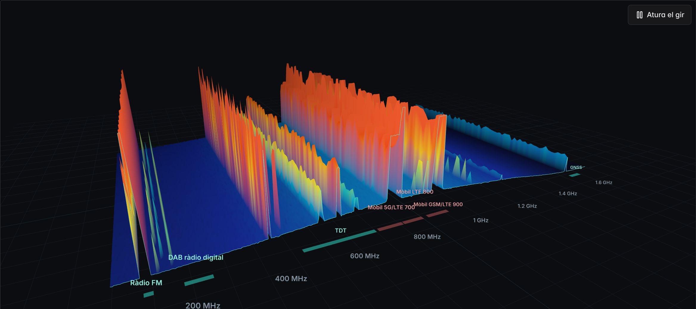
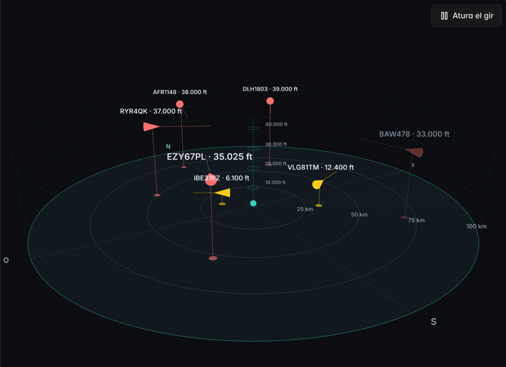
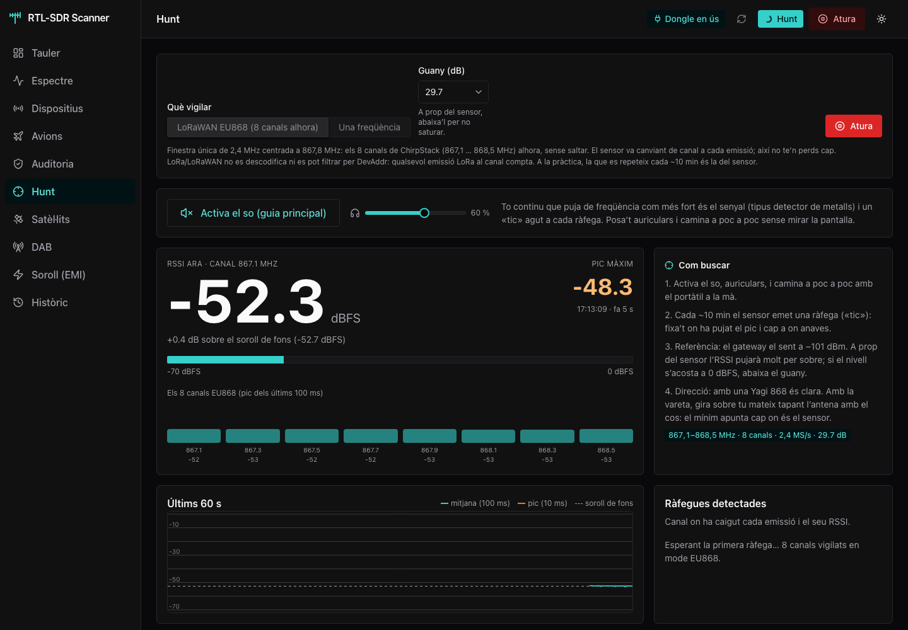
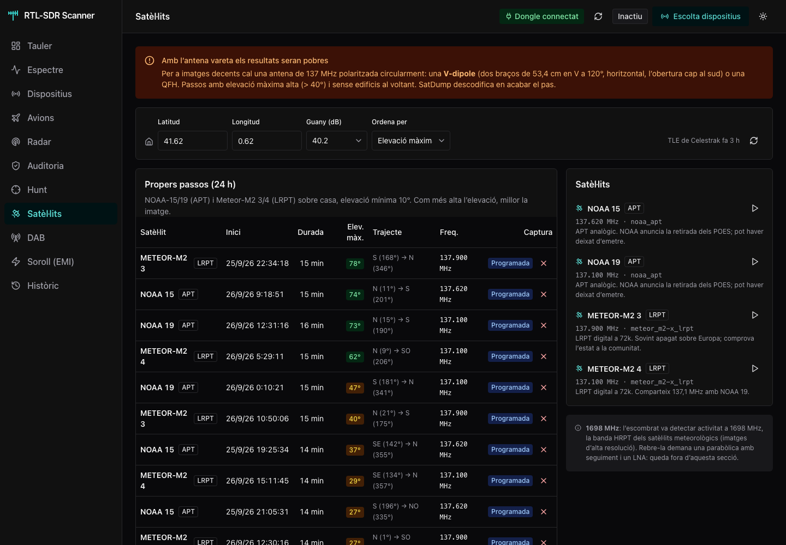
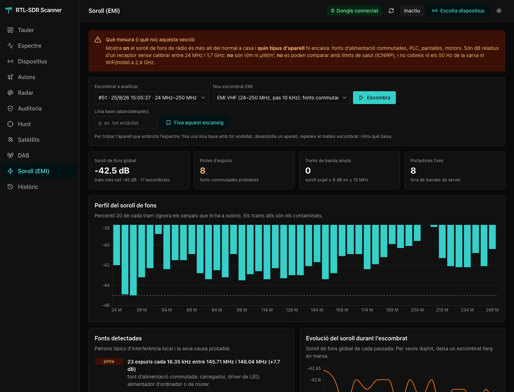
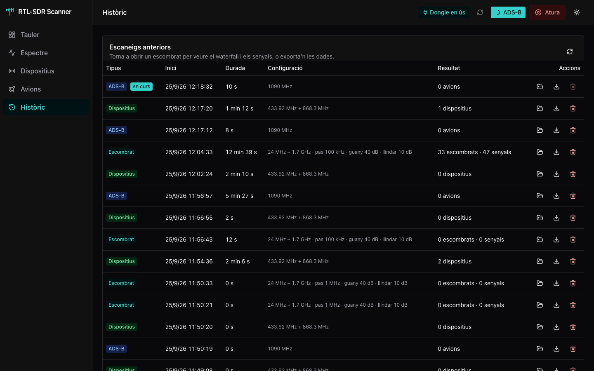

# RTL-SDR Scanner

**English** · [Català](README.ca.md)

A local web app to find out which radio signals are around you with an **RTL-SDR Blog V3** dongle and, when possible, which device sends them and what it says. Receive only.

It runs entirely on your machine: the server talks to the dongle, the browser shows the result, and everything you capture stays in a local SQLite file. Nothing is uploaded anywhere.



> **Status:** a personal project that works on my setup (macOS, RTL-SDR Blog V3, stock antenna). The interface is in Catalan for now. Feedback on what is missing or wrong is very welcome: open an issue.

## What it does

- **Spectrum**: sweeps with `rtl_power`, live waterfall, peak detection over the noise floor and classification by band (Spain/EU allocations).
- **3D spectrum**: the same sweeps as a landscape you can orbit: width is frequency, height is level, depth is time. It is the waterfall in volume, not a map of where signals come from (one antenna has no direction).
- **Devices**: `rtl_433` hopping between 433.92 and 868.3 MHz. Deduplicated by model + id + channel, with reading history, aliases and a "probably mine / neighbours" filter based on signal strength.
- **Aircraft**: ADS-B at 1090 MHz with `rtl_adsb` (ICAO address, country from the ICAO block, callsign, altitude, position, speed, heading).
- **Radar**: a plan view centred on your home position. Aircraft are drawn at their real position with a trail; other devices sit on RSSI rings with unknown direction (or a manual bearing, if you found it with a directional antenna).
- **3D radar**: the same aircraft in three dimensions around your home: real bearing, distance and altitude, with a stem to the ground, the track flown and where each one will be in two minutes. Only aircraft are shown, because only they report a position.
- **Audit**: the radio exposure of your own home. What transmits in the clear, what can be identified by a fixed ID, daily routines, and recommendations. Metadata of your own devices only.
- **Hunt**: find a lost LoRaWAN sensor. In EU868 mode it watches the 8 channels (867.1–868.5 MHz) at once in a single 2.4 MHz window (raw IQ from `rtl_sdr`, own channeliser), with per-channel RSSI 10 times a second, a burst list, and a metal-detector-style tone so you can walk around without looking at the screen.
- **Satellites**: NOAA-15/19 (APT) and Meteor-M2 3/4 (LRPT) passes from Celestrak TLEs (SGP4), scheduled captures decoded by **SatDump**, and a gallery of the images.
- **FM radio**: listen to broadcast FM stations found in the sweep (`rtl_fm` → PCM → Web Audio). Broadcast only: no other band is played.
- **DAB**: digital radio decoded by `welle-cli` inside Docker, connected to `rtl_tcp` on the host.
- **Noise (EMI)**: local interference from the sweeps: noise-floor profile, spur combs (switching power supplies), wideband stretches (PLC, motors), fixed carriers, and before/after comparison against a baseline to find the appliance that pollutes the spectrum. Relative dB, uncalibrated: it does not measure V/m or health limits.
- **dBm calibration**: with a signal of known level, the app stores the offset per gain. Without one it estimates from typical R820T values (±6 dB).
- **History**: every scan is saved to SQLite and can be reopened and exported (CSV/JSON).





*The two 3D views, here with synthetic data.*

| Hunt (LoRaWAN EU868) | Satellites |
| --- | --- |
|  |  |

| Noise (EMI) | History |
| --- | --- |
|  |  |

## What it does not do

- It never transmits.
- It does not decode or record private communications. Encrypted bands (mobile, TETRA) only show "activity detected".
- LoRa/LoRaWAN payloads are not decoded; Hunt only measures power.
- DVB-T television is not possible with this dongle in SDR mode (it needs 9 MS/s and the dongle reaches 2.4).

## Requirements

- macOS with Homebrew, Node 22+ and pnpm. Linux should work wherever the `rtl_*` tools do, but it is untested.
- SDR tools: `brew install librtlsdr rtl_433`.
- Satellites (optional): `brew install satdump` (cask; it leaves `SatDump.app` in `/Applications`). If yours lives elsewhere: `SATDUMP_BIN=/path/to/satdump`.
- DAB (optional): Docker running and the decoder image built with `docker build -t rtlsdr-decoders docker/decoders`. Docker Desktop on macOS cannot reach USB, so the dongle is served by `rtl_tcp` on the host (port 1234) and the container connects to it.
- Check the dongle: `rtl_test -t` should list `Realtek, RTL2838UHIDIR`.

## Run it

```bash
git clone https://github.com/Celtico/rtlsdr-scanner.git
cd rtlsdr-scanner
pnpm i
pnpm dev          # server on http://localhost:4000, web on http://localhost:5173
```

Other commands: `pnpm build`, `pnpm typecheck`, `pnpm lint`, `pnpm test` (vitest on the server, with fixtures captured from the dongle).

Optional server variables: `PORT` (4000), `SDR_DB` (database path, default `data/sdr.db`), `SDR_SAT_DIR` (satellite captures, default `data/satellite`), `SATDUMP_BIN`, `SDR_DEBUG=1` (shows stderr of the `rtl_*` tools).

Set your own position in the Radar tab; it is used for the radar and for satellite pass prediction. The default is the centre of Lleida, Spain.

## How it is built

A pnpm monorepo with two packages:

- `server/`: Node 22, TypeScript, Fastify + WebSocket. It launches the SDR tools as child processes and pushes events in real time. `sdr/manager.ts` is the single owner of the dongle: one active mode at a time, a queue, and clean shutdown of the previous tool before the next one takes the USB device.
- `web/`: Vite + React + TypeScript with Chakra UI v3. The waterfall and the radar are plain `<canvas>`.

Data lives in SQLite (`better-sqlite3`) under `data/`, which is git-ignored.

## API

| Method | Route | Description |
| --- | --- | --- |
| GET | `/api/status` | active mode, dongle state, counters |
| POST | `/api/mode` | `{ mode: 'idle' \| 'survey' \| 'devices' \| 'adsb' \| 'hunt' \| 'audio' \| 'dab', config }` (`satellite` mode is started from scheduled captures) |
| GET | `/api/audio/stream` | PCM s16le mono 48 kHz of the FM station being played |
| GET / POST / DELETE | `/api/emi?scanId=`, `/api/emi/baseline` | EMI analysis of a sweep, set/clear the baseline |
| GET / POST / DELETE | `/api/calibration`, `/api/calibration/reading?scanId&freqHz`, `/api/calibration/:gain` | calibration references, reading of a sweep at one frequency |
| GET / POST | `/api/dab/channels`, `/api/dab/mux`, `/api/dab/channel`, `/api/dab/mp3/:sid` | blocks, multiplex state (welle-cli proxy), block change, audio of one programme |
| POST | `/api/dongle/check` | runs `rtl_test -t` (idle mode only) |
| GET | `/api/bands` | band table |
| GET | `/api/signals?scanId=` | detected signals |
| GET | `/api/sweeps?scanId=&limit=` | sweeps (to reopen a waterfall) |
| GET | `/api/devices` | rtl_433 devices |
| GET | `/api/devices/:id/history` | readings of one device |
| PATCH | `/api/devices/:id` | `{ alias?, owner?: 'own' \| 'other' \| null, bearingDeg? }` |
| GET | `/api/audit` | exposure, hourly activity and routines of your own devices |
| GET | `/api/satellite/info`, `/api/satellite/passes?lat&lon&hours`, `/api/satellite/captures` | satellites, predicted passes, captures |
| POST / DELETE | `/api/satellite/captures[/:id]` | schedule (or start with `now: true`) and cancel captures |
| GET | `/api/satellite/files/:id/*` | images of one capture |
| GET | `/api/planes?scanId=` | aircraft |
| GET | `/api/scans`, `/api/scans/:id`, DELETE `/api/scans/:id` | history |
| GET | `/api/export/:kind?format=csv\|json&scanId=&deviceId=` | `signals`, `devices`, `planes`, `sweeps`, `readings` |
| GET | `/api/satellite/antenna` | `reference/antena-137mhz.md` (V-dipole dimensions) |
| WS | `/ws` | `status`, `survey:sweep`, `survey:signals`, `device:new`, `device:update`, `adsb:plane`, `hunt:level`, `hunt:burst`, `satellite:capture`, `error` |


## Notes

- Only one process can use the dongle. Changing mode stops the previous one and waits for it to release the USB device.
- `rtl_power` with a 1 MHz step hops one bin per MHz (about 73 s per pass from 24 to 1700 MHz). With steps of 500 kHz or less each hop covers 2.8 MHz (about 23 s per pass), which is why the default step is 100 kHz.
- Satellites: the scheduler starts the capture 20 s before AOS and takes the dongle even if another mode is active. SatDump always produces images, even from noise: check the quality in the gallery. With the stock whip antenna results are poor; a 137 MHz V-dipole (two 53.4 cm arms at 120°) or a QFH is needed. See `reference/antena-137mhz.md`.

## Privacy and the law

The app shows what your receiver hears, which includes devices that are not yours. Receiving is legal in most places, but what you may do with what you receive is not the same everywhere: check your local rules, do not publish other people's device identifiers, and never use a captured code to operate something that is not yours.

## License

[MIT](LICENSE)
